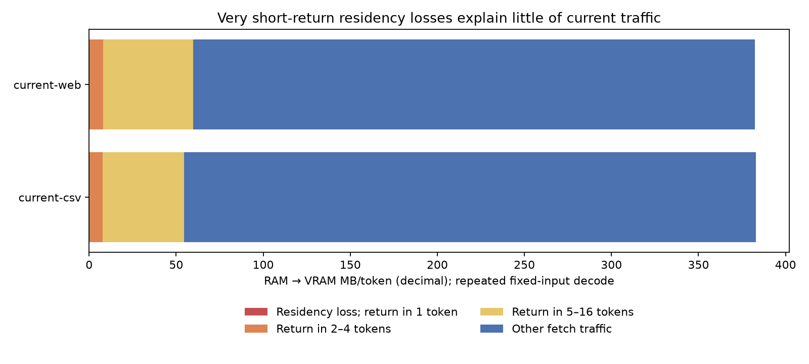

# Residency churn audit — 2026-10-13

## Verdict

The current cache does not exhibit large immediate eviction/refetch thrashing on these two short fixed-input tasks. It serves about 70% of expert selections from VRAM. Only about 2.1% of repeated GPU fetch bytes concern an expert last observed resident within four tokens. A simple stricter admission rule made replay worse on both tasks. Retain the current policy.

## Direct measurements

Each process uses the retained transition/overlap configuration, 22 GiB GPU pool, 101 GiB RAM budget, 24 GiB shadow allowance, no MTP, and two sequential identical requests. CSV has 128 decode tokens/request; web uses its frozen continuation. The short prompts also run through route logging. Rows below exclude prompts. These are diagnostic runs, not new unprofiled TPS claims.

| Task / request | Fetch MB/token | Resident hit % | Loss → return ≤1 token, MB/t | ≤4 tokens, MB/t | ≤16 tokens, MB/t |
|---|---:|---:|---:|---:|---:|
| current-csv / 1 | 464.14 | 64.35 | 6.47 | 19.71 | 69.44 |
| current-csv / 2 | 383.00 | 70.12 | 0.13 | 7.90 | 54.46 |
| current-web / 1 | 480.14 | 63.37 | 9.20 | 23.50 | 76.18 |
| current-web / 2 | 382.49 | 69.92 | 0.26 | 8.01 | 59.87 |

The return columns are cumulative. A loss means the expert was a logged hit or confirmed admission at its preceding use, and is now off-GPU. The interval is between demands, not eviction-to-demand latency. CPU-served returns are counted as losses in raw JSON but do not contribute to these GPU-byte columns. Losing residency does not prove a bad eviction: retaining that expert may displace a more useful one.

## Causal admission screen

Before looking at results, fixed a single rule: only admit a fetched expert if its aged frequency is at least 1.5× that of the current transition-selected resident victim. Rejected fetches still compute through scratch; no expert computation is skipped. No future demand is consulted; no rule fitting between CSV and the held-out web task. This is an offline screen, not a production implementation.

Replay models actual GPU-only admission (at most three spare slots per layer), CPU selection, count aging and transition scoring. It remains approximate: boundary ordering, asynchronous slot states, exact device counters and tie ordering are not reproduced. In particular, admission decisions are sequential here, whereas production fills spares then evicts at the boundary.

| Repeated task | Actual MB/t | Replay current MB/t | Replay strict admission MB/t | Change | Current replay residency-mask disagreement |
|---|---:|---:|---:|---:|---:|
| current-csv | 383.00 | 383.16 | 425.09 | +10.94% | 0.084% |
| current-web | 382.49 | 382.64 | 429.78 | +12.32% | 0.116% |

Baseline replay fidelity is strong here; it does not validate every counterfactual policy. Reject this simple admission rule as a live implementation candidate for now. It is not evidence against every admission policy.

## Admission survival

| Repeated task | Admissions | With observed later demand | Still resident at that demand | Lost before demand | No later demand in trace |
|---|---:|---:|---:|---:|---:|
| current-csv | 5079 | 3659 | 1700 | 1959 | 1420 |
| current-web | 5132 | 3767 | 1712 | 2055 | 1365 |

Counts are attributed to the admission phase. Absence of later demand is right-censored, not proof that an admission was useless. More than half of observed returning admissions lose residency, but very short-return losses are rare. This points to predicting medium/longer reuse, not an obvious failure to protect the next token.

## What this does and does not establish

- GPU pool has 2,693 slots across 42 × 288 experts. Reserving three spares/layer leaves roughly 21.2% of expert identities resident; mixed quant sizes mean this is not a weight-byte fraction. About 70% selection hits are meaningful evidence that residency concentrates useful experts.
- The historical 411→228 MB/token oracle used different, simplified all-miss admission. It is neither a guaranteed achievable saving nor a rigorous current-policy capacity lower bound.
- We cannot identify all unavoidable misses from this audit. Four-token return traffic is a diagnostic category, not a bound on all possible savings. Even the 54–60 MB/token returning within 16 tokens cannot all be eliminated for free.
- This covers two short fixed-input tasks, first and repeated requests; it does not establish behavior for long contexts, arbitrary task switches or free generation. No settings were changed.
- Next residency work should require an evidence-backed predictor of reuse over tens of tokens, evaluated on a separate task. A blanket frequency admission margin is not justified. Transfer/CPU memory contention remains a separate proven bottleneck.

## Validation and artifacts

- current-csv, repeat 0: route fetch bytes, hits and admissions match engine counters exactly.
- current-csv, repeat 1: route fetch bytes, hits and admissions match engine counters exactly.
- current-web, repeat 0: route fetch bytes, hits and admissions match engine counters exactly.
- current-web, repeat 1: route fetch bytes, hits and admissions match engine counters exactly.
- current-csv: all 39,649,280 logits exactly equal retained reference maya-transfer-attribution/replay-stamps; maximum difference 0.

Opt-in route logs now append a fourth mask (actual promotions) before `|`; the first three masks and near-ID parsing remain compatible. Engine compute/scheduling is unchanged. Raw routes, manifests, token fixtures, counters and audit.json are retained beside this report. Large logits remain local and untracked. Build emitted existing CUDA/C++ warnings; no new compiler failure.

Reproduce: `.venv/Scripts/python.exe tools/audit_residency_churn.py docs/evidence/maya-churn/current-csv docs/evidence/maya-churn/current-web`, then `tools/report_residency_churn.py`.
