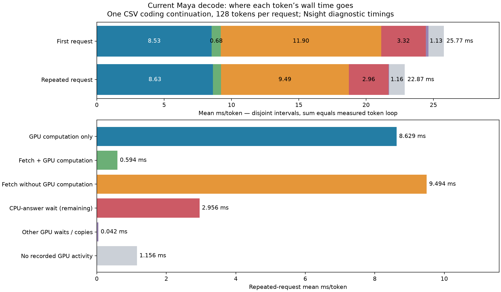

# Fresh retained-candidate decode profile — 2026-10-13

One frozen CSV coding continuation, 30 prompt tokens and 128 decode tokens,
two sequential requests in one process. Same retained configuration and packed
weights as the churn audit; no engine optimization in this measurement.
Nsight CUDA/NVTX capture, individual graph nodes, no CPU sampling.

| Mutually exclusive observed interval | First request ms/token | Repeated request ms/token |
|---|---:|---:|
| GPU computation without fetch | 8.534 | 8.629 |
| Fetch concurrent with GPU computation | 0.678 | 0.594 |
| Fetch without GPU computation | 11.903 | 9.494 |
| Remaining CPU-answer wait | 3.316 | 2.956 |
| Other GPU waits / copies | 0.205 | 0.042 |
| No recorded GPU activity | 1.132 | 1.156 |
| Whole loop | **25.768** | **22.871** |

This is an activity partition, not proof that each interval can be removed.
Fetch-only means no GPU arithmetic at that instant; CPU work may be concurrent.
CPU-answer waiting can depend on useful CPU execution. No-GPU time is not
automatically wasted CPU time. Computation takes attribution precedence over
copies and waits, followed by fetch, CPU-answer waits, then other waits/copies.
Every token's disjoint intervals reconcile to its measured wall time.

Warm total fetch duration: 10.088 ms for 383.000 MB/token, or 37.97 GB/s useful
payload. Only 0.594 ms (5.9%) of this fetch interval overlaps GPU computation.
GPU arithmetic totals 9.223 ms including that overlap. D2H duration is 0.0215 ms
and 1.137 MB/token. Warm 22.871 ms corresponds to 43.72 token loops/s under the
profiler; this is not a separately qualified unprofiled throughput result.

Fetch substages (warm): whole-expert pulls 2.831 ms; gate/up prefix 4.974 ms;
down component 2.284 ms. Mean prefix-ready to gate/up launch gap is 0.857 us
per layer. Mean down-dependencies-ready to down launch gap is 0.881 us.
These small layer-local gaps do not account for the full no-GPU interval.

[Detailed GPU substages](latest/deep-stages.png)

[Representative warm token's layer timeline](latest/deep-layer-timeline.png)

All 39,649,280 recorded logits match the preceding current-csv retained run
exactly. Fetch accounting reconciles NVTX masks to engine byte counters for
every token; GPU slot count remains 2,693. Diagnostic timing differs slightly
from the earlier 23.495 ms capture; no performance improvement is claimed.
Neither long-context behavior nor cross-workload timing is established here.

Inference exited and released the GPU. Nsight spent additional time finalizing
the capture after inference; that time is outside the token measurements.
Raw Nsight/SQLite/logit files remain local; manifests, derived tables and graphs
are checkpointed. Reproduction uses tools/run_transfer_lab.py (exact settings
in latest/manifest.json), analyze_transfer_trace.py, analyze_deep_profile.py,
and plot_decode_partition.py.
