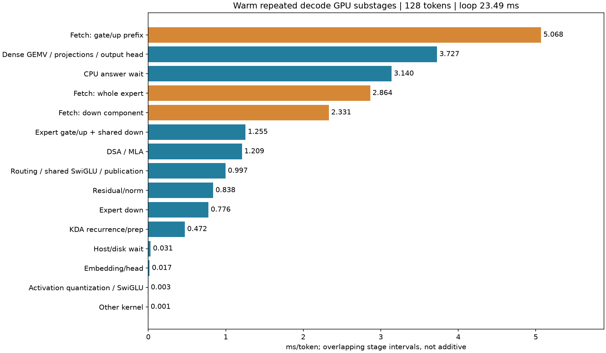
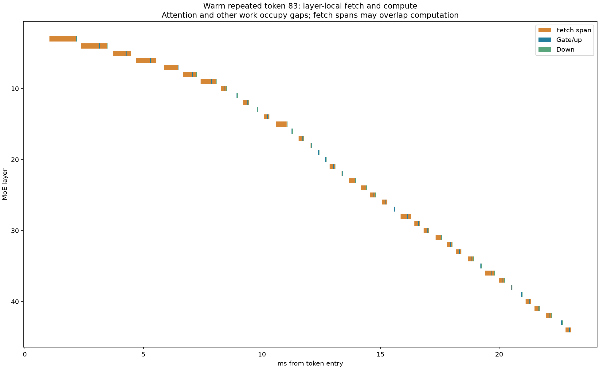

# Deeper Maya decode profiling — 2026-10-13

One CSV fixed-input workload, 30 prompt tokens and 128 scored continuations,
first then repeated in the same process. Retained transition/captured-overlap
configuration, same weights, 22 GiB expert pool and RAM backing. No inference
algorithm changes. This is diagnostic profiling, not a new unprofiled TPS result.

## Answers

Warm demand is **383.00 MB/token**, fetch-kernel interval union **10.263 ms**,
effective useful-payload bandwidth **37.32 GB/s**. The Gen5 x16 encoding-adjusted
ceiling is 63.015 GB/s, implying **6.078 ms** before protocol overhead. That is a
lower bound, not a prediction of application performance.

There is no warm expert repacking stage: mapped GPU reads copy already packed
quantized weights to GPU slots. Dequantization is fused into arithmetic. All
recorded layer fetch bytes reconcile exactly with fixed.csv token counters.
Physical DRAM service, PCIe transactions and GPU read/write stalls overlap within
the same kernel; Nsight Systems cannot split that kernel into those physical
components. We have NOT measured 4.185 ms of a particular PCIe or RAM stall.

Warm route-kernel-end to fetch-start totals only **0.081 ms/token**. Gate/up
starts **0.889 microseconds** after its required prefix is ready (p95 2.816 us).
Down starts **0.876 us** after both gate/up and fetched weights are ready
(p95 2.784 us). There is no substantial ready-but-not-consumed delay here.

Streaming is layer-local, not an all-layers loading barrier. In 31 captured MoE
layers, gate/up prefixes arrive first, then gate/up runs while down weights are
fetched on the side stream. Eleven other MoE layers use whole-expert fetches.
Down-copy overlap is **0.608 ms/token**, but **1.719 ms/token** of down-copy tail
still remains after gate/up finishes. Prefix copies themselves take **5.068 ms**.
The current group launch waits for all required GPU gate/up prefixes; it does not
start each resident/arrived expert independently. The next layer's true route
depends on preceding computation, preventing exact arbitrary lookahead.

## GPU and transfer measurements

| Metric (ms/token unless stated) | First | Repeated |
|---|---:|---:|
| Token wall time | 26.306 | 23.495 |
| Expert fetch | 12.582 | 10.263 |
| GPU arithmetic, interval union | 9.312 | 9.294 |
| CPU-answer wait kernels (partly overlapping) | 3.694 | 3.140 |
| GPU inactivity | 1.186 | 1.363 |
| D2H copies | 1.357 | 0.022 |
| Fetch/arithmetic overlap | 0.682 | 0.608 |
| Demand MB/token | 464.141 | 383.000 |

Intervals overlap and are not additive. CPU wait kernel duration is not all
recoverable delay. Allocation capacity is not occupied context: this is a short
context only. Earlier unprofiled warm 45.20 TPS remains a separate measurement.

| Warm transport component | MB/token | ms/token | Effective GB/s |
|---|---:|---:|---:|
| Whole experts, uncaptured path | 105.95 | 2.864 | 37.00 |
| Gate/up prefixes, captured path | 184.70 | 5.068 | 36.44 |
| Down components, captured path | 92.35 | 2.331 | 39.62 |



GPU arithmetic is broken into dense projections/head, expert gate/up plus fused
shared down, routed down, DSA/MLA, KDA, residual/norm and routing/shared activation
preparation. Individual CUDA kernel names, quant specializations, launch counts
and durations are in `warm-detail/deep-kernel-means.csv`. Fused kernels cannot
be attributed to separate internal instructions by this timeline. Dense GEMV
includes the output head; the small embedding/head bar is only its separately
named prep/selection kernels, not total head cost.



The orange span can contain the gap between prefix and down copies, rather than
claiming uninterrupted PCIe activity. Attention and other work occupy the gaps
between MoE layers. Detailed rows retain individual token/layer readiness times.

## Isolated transport checks

Extended the existing byte-exact copy benchmark with grid size, component size,
per-expert loop and rotating-source controls. Tested Q2_K/Q3_K/Q4_K-sized payloads;
all readbacks exact. These tests move bytes, not model arithmetic.

Whole expert hot-buffer checks: mapped pull roughly 47–53 GB/s; DMA 56–58 GB/s.
A repeated 1 GiB rotating pinned source avoids interpreting a tiny hot CPU-cache
working set as full-model RAM throughput:

| Rotating source | Mapped sequential pull | DMA |
|---|---:|---:|
| One 8.26 MB Q2-sized expert, 170 blocks | 52.22 GB/s | 57.38 GB/s |
| Four experts, 170 blocks | 52.09 GB/s | 57.03 GB/s |
| One 2.75 MB down component, 32 blocks | 49.82 GB/s | 56.60 GB/s |
| Four down components, 32 blocks | 52.74 GB/s | 57.40 GB/s |

Earlier small-component samples varied materially as the short benchmark warmed
up (31–50 GB/s). They are retained, not cherry-picked away. The larger/warmed
checks show that neither a 32-block grid nor a per-expert loop *alone* explains
the live 37 GB/s. Expanding the source to 1 GiB did not reproduce the live loss.
These do not reproduce 98 GiB pinned memory, live CPU expert traffic, pointer
indirection, fragmented placements or competing inference work. No claim of a
controlled attribution among those factors is made.

At the same 383 MB, 57 GB/s would require 6.72 ms; 52 GB/s would require 7.37 ms.
Thus the observed 10.26 ms is about 2.90 ms above isolated mapped-copy capability,
not 4.19 ms of pure software overhead. These are counterfactual bandwidth
comparisons, NOT additive measured stages or promised token-time savings. A
DMA redesign must overcome its previously measured scheduling overhead.

Next decisive isolation is replaying actual scattered source addresses and
per-layer transfer sizes against the allocated tier, with CPU consumers on/off,
then computation overlap on/off. This would distinguish live memory contention
from address-layout and GPU resource effects. Hardware counters would be needed
for exact within-kernel DRAM/PCIe/SM stall attribution; do not infer it from this
timeline. No further inference sweep was run for the present profiling request.

## Validation and reproducibility

- All 256 scored tokens reconcile route NVTX bytes with engine counters.
- Exactly 42 MoE route records per token, layers 3–44, paired with 42 GPU routes;
  all fetch/consumer pairings and nonnegative readiness intervals checked.
- **39,649,280 logits exactly match** the retained unprofiled combined candidate,
  maximum absolute difference zero. This is same-backend profiling validation,
  not a new claim of hybrid-versus-GPU numerical parity.
- Native component lengths derive from quant block geometry, not file-offset
  differences (which can include intervening data); this analyzer rejects other
  quant layouts. Its scope is this model's Q2_K/Q3_K/Q4_K geometry.
- No engine arithmetic/ownership changes. Model exited and GPU was released.
- Heavy SQLite/raw logits remain local, uncommitted; manifests and summaries
  preserve binary/model hashes, counters and settings.

Reproduce the capture:

```powershell
.venv/Scripts/python.exe tools/run_demand_lab.py warm-detail --evidence-root docs/evidence/maya-deep-profile --trace --repeats 2 --env STRATA_GLM_KDA_GRAPH=1 --env MAYA_REUSE_POLICY=transition --env MAYA_OVERLAP_BLOCKS=32 --env MAYA_OVERLAP_CAPTURED_ONLY=1
.venv/Scripts/python.exe tools/analyze_transfer_trace.py docs/evidence/maya-deep-profile/warm-detail
.venv/Scripts/python.exe tools/analyze_deep_profile.py docs/evidence/maya-deep-profile/warm-detail
```

Use a fresh output name to preserve existing traces. Transport tool arguments are
payload path, optional block count, optional byte count. Set
`MAYA_TRANSPORT_ROTATE_MB=1024` for rotating sources; unset for original hot-buffer
behaviour. Three copy modes: contiguous mapped pull, DMA, per-expert-loop pull.
