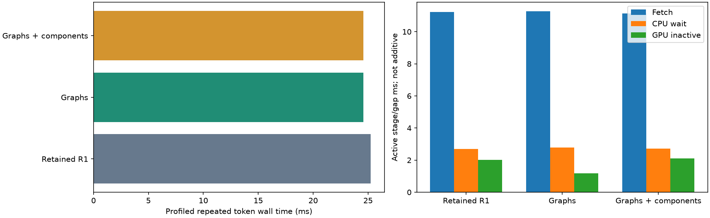
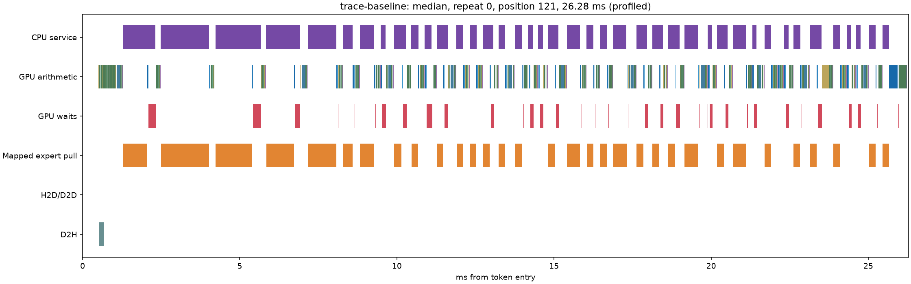
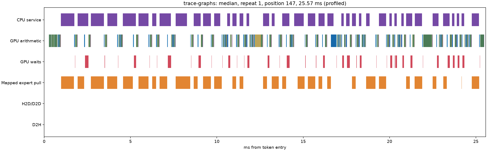
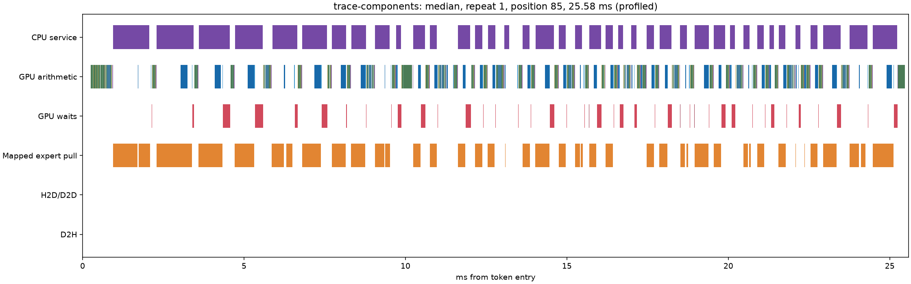

# Maya demand-transfer campaign: incremental results

This campaign starts from the **previous retained candidate `20af539`**, including expanded immutable RAM backing and after-embedding demotion scheduling. Its gains over stock Maya are not gains of this campaign. Same GSQ-RCO 3.0bit Q4-attention pack, c=1, no speculative token decoding, MTP, K4V, expert skipping or additional quantization. **60 TPS has not been measured.**

Seven distinct hypotheses were exercised. The simplest promising candidate enables Maya's existing KDA layer graph replay. This is a modest scheduling/configuration improvement, not a newly invented graph engine. Rejected policy/transport prototypes remain preserved separately. The preceding campaign's demotion fix was not reimplemented.

## Baseline versus graph candidate

Unprofiled, without route logging. Short fixture: 30 prompt tokens, then 128 forced inputs; two repetitions with tier adaptation. Long fixture: 8,192 actually occupied source-code tokens, then 128 forced inputs. Allocation capacity 131,072 is not occupancy. Both use a 22 GiB expert pool and the previous RAM backing settings.

| Fixture | Retained R1 TPS | Graph TPS | Change | Mean ms/token | p95 ms/token |
| --- | --- | --- | --- | --- | --- |
| Short first | 38.22 | 39.31 | +2.9% | 26.16 → 25.44 | 30.68 → 29.56 |
| Short repeated | 41.39 | 42.85 | +3.5% | 24.16 → 23.34 | 28.58 → 27.80 |
| 8K occupied first | 34.66 | 35.90 | +3.6% | 28.85 → 27.85 | 36.44 → 35.61 |
| 8K occupied repeated | 36.40 | 37.81 | +3.9% | 27.47 → 26.45 | 31.91 → 30.86 |

Short confirmation uses the experimental executable with other new switches off. Final free generation and 8K qualification use **the same preserved R1 executable on both sides**, with only graph replay changed. Prior campaign repeat variation was ~4%; do not sell a single 3–4% difference as a precisely established universal speedup.

## Writing/coding and workload transitions

One process per side: warmup, CSV → explanation → HTML/JavaScript, then repeat. Same greedy prompts and 128-output-token cap. This checks cross-task cache transitions; these are continuations, not completed webapp tasks or a model-quality benchmark.

| Task, two requests pooled | Retained R1 TPS | Graph TPS | Change | Same output IDs |
| --- | --- | --- | --- | --- |
| csv | 36.50 | 37.87 | +3.8% | True |
| explanation | 38.92 | 40.54 | +4.2% | True |
| web | 36.18 | 37.38 | +3.3% | True |

## Hypotheses/results matrix

These screens enabled route logging (which also computes 16 near ranks). They are **diagnostic**, not directly comparable to the unlogged headline. The initial retained route collection overlapped CPU compilation; use it for route/capacity evidence, not a definitive timing baseline.

| ID | Mechanism | First / repeat TPS | Verified engagement | Decision |
| --- | --- | --- | --- | --- |
| D1 | Cost/reuse-weighted layer residency | 37.69 / 40.69 | Train writing/web; hold out CSV; same byte pool. Demand falls only ~2%. | No incremental retention: graph+placement does not materially beat graphs. |
| D2 | LRU versus aged-frequency eviction | 37.21 / 39.17 | Actual repeat demand rises, consistent with fixed-route replay. | Reject. |
| D3 | Component-ready GU/down streaming | 36.50 / 39.49 | Original single gate/up; down fetch on side stream; graph-compatible fork/join. | Reject: measured overlap offset by contention and gaps, including with graphs. |
| D4 | Independent expert pulls in one grid | 37.30 / 40.27 | Same bytes, destinations and exact logits; no extra host handshake. | No justified gain alone or with graphs. |
| D5 | Layer graph replay | 38.85 / 41.91 | 34 captures, 10,710 replays; exact logits and ordered routes. | Simplest candidate; modest gains require workload-specific interpretation. |
| D6 | Measured per-layer CPU/GPU balance | 37.54 / 38.90 | Cost model changes seven of 42 plans; actual masks/traffic change. | Reject: extra complexity without speed gain. |
| D7 | Selective rank-0 demand-first prediction | 37.37 / 40.11 | ~96% of prefetched bytes selected next, but total H2D rises. | Reject: selected does not mean avoided GPU demand. |

Mechanisms, source references, pre-experiment bounds and falsifiers: [campaign plan](../../../MAYA-DEMAND-CAMPAIGN.md), [research/audit](../RESEARCH.md). Public grounding reuses archived CUDA/Fiddler/ProMoE material and measured local DS4/Strata failures; publications are not treated as measured gains on this machine.

### Policy-stage diagnostic checks

Separate CUDA-event runs, 128 scored tokens each after skipping the 30 prompt forwards. Event intervals include submission gaps and instrumentation overhead; these are first-request diagnostic intervals, not kernel-only durations, repeated-request numbers or headline throughput. Full stage values are in stage-diagnostics.json. Prediction/placement change CPU assignment and can change routing, so this is an end-to-end mechanism screen rather than an arithmetic-controlled comparison.

| Policy | Stream ms/token | Fetch stage | CPU-answer wait | Route stage | Gate/up | Down |
| --- | --- | --- | --- | --- | --- | --- |
| baseline | 26.660 | 12.666 | 2.439 | 1.183 | 1.281 | 0.882 |
| placement | 26.960 | 12.492 | 2.520 | 1.215 | 1.328 | 0.921 |
| lru | 26.670 | 12.550 | 2.457 | 1.188 | 1.287 | 0.921 |
| batch | 25.780 | 12.509 | 2.311 | 1.137 | 1.257 | 0.873 |
| cpu | 26.490 | 12.512 | 2.534 | 1.181 | 1.293 | 0.902 |

The optional prediction event-stage diagnostic was interrupted during model loading and was not rerun. Its completed main experiment already establishes increased total upload traffic and no retained benefit. Following the updated testing instruction, future iterations select one or two decisive tests rather than automatically rerunning this matrix.

## Dependencies and combinations

| Complete combination | First / repeat TPS |
| --- | --- |
| graphs | 38.85 / 41.91 |
| graph-batch | 38.61 / 41.69 |
| graph-components | 39.10 / 41.82 |
| graph-placement | 39.80 / 42.95 |
| confirm-graphs | 39.31 / 42.85 |

The first three rows use route logging; the last two are unlogged. Compare graph-batch/components against graphs, and graph-placement against confirm-graphs, not across instrumentation groups.

D1 changes residency and therefore CPU placement; D6 models CPU completion versus added transfer rather than treating every CPU wait as removable. D3 needs low submission overhead, so D3+D5 includes a captured cross-stream event fork/join. D4+D5 tests whether the batched copy mapping becomes useful once host launches are reduced. D1+D5 barely changes the graph-only result. D7 starts predicted movement after demand/CPU work and restricts rank, but still adds uploads. No exhaustive parameter sweep was used.

## Capacity and transfer accounting

| Fixed-route replay model | GPU demand MB/token | Missed experts/token |
| --- | --- | --- |
| original-lfu | 411.4 | 106.8 |
| original-lru | 467.1 | 119.0 |
| original-oracle | 228.5 | 65.8 |
| trained-lfu | 401.9 | 106.2 |
| trained-lru | 461.5 | 118.9 |
| trained-oracle | 214.6 | 64.1 |

Replay includes 316 prompt+continuation histories, simplified spares/admission and a global CPU split. Future-oracle numbers assume inaccessible future knowledge and no migration scheduling costs. They are an **optimistic opportunity estimate, not a rigorous hardware/engine lower bound or achieved TPS**. The remaining traffic is not demonstrably all unavoidable, but the tested causal allocation policy removes only a small fraction. Actual placement changes can alter routing numerically; the replay deliberately fixes routes and is kept separate from real measurements.

| Repeat | Demand MB/token | Predicted MB | Selected prediction MB | Demotion MB | GPU hits/token | CPU experts/token | Pool GiB | Pinned tier GiB |
| --- | --- | --- | --- | --- | --- | --- | --- | --- |
| baseline | 413.79 | 0.00 | 0.00 | 0.71 | 228.9 | 63.6 | 22.00 | 97.82 |
| confirm-graphs | 413.79 | 0.00 | 0.00 | 0.71 | 228.9 | 63.6 | 22.00 | 97.82 |
| trained-placement | 406.32 | 0.00 | 0.00 | 1.74 | 228.8 | 63.9 | 22.00 | 97.82 |
| lru | 433.82 | 0.00 | 0.00 | 32.26 | 224.4 | 65.8 | 22.00 | 97.82 |
| cpu-plan | 412.11 | 0.00 | 0.00 | 0.78 | 229.0 | 63.8 | 22.00 | 97.82 |
| selective-predict | 373.29 | 79.90 | 76.54 | 0.88 | 236.9 | 59.7 | 22.00 | 97.82 |

Prediction engagement distinguishes selected bytes from counterfactual demand saved: an expert otherwise assigned to CPU can be predicted correctly but add a GPU upload. Exact per-expert displaced traffic and prediction deadline distributions were not instrumented after the aggregate screen rejected this variant; do not claim those measurements. Warm demotions remain almost zero in the primary candidate. Graph replay does **not** reduce the ~414 MB/token demand.

| Run | Minimum available physical GiB | Minimum available commit GiB |
| --- | --- | --- |
| baseline | 12.26 | 23.80 |
| confirm-graphs | 12.13 | 23.76 |
| long-baseline | 11.99 | 23.75 |
| long-graphs | 11.97 | 23.67 |
| trace-baseline | 8.20 | 20.24 |
| trace-graphs | 7.19 | 19.38 |

| Whole-run samples | Peak VRAM GiB | Graphics MHz range | Memory MHz range | Peak °C |
| --- | --- | --- | --- | --- |
| baseline | 30.17 | 1065–2632 | 405–16701 | 46 |
| confirm-graphs | 30.17 | 990–2632 | 405–16701 | 48 |
| long-baseline | 30.19 | 1020–2632 | 405–16701 | 56 |
| long-graphs | 30.19 | 990–2632 | 405–16701 | 56 |
| trace-baseline | 30.28 | 1012–2632 | 405–16901 | 50 |
| trace-graphs | 30.28 | 1027–2632 | 405–16901 | 51 |

No extra expert RAM/pool capacity is credited to graphs. Hardware samples are in each fixed-run gpu.csv (including loading/prefill/idle). VRAM clocks/thermals were not locked or changed by the campaign; these are bounded trials, not statistical confidence intervals. Profiler overhead and cache capacity are recorded separately.

## New diagnostic timelines

Nsight node-level graph tracing is explicitly enabled; otherwise graph launches could hide their constituent kernels. Stage intervals overlap and must not be summed. CPU-wait kernel time includes polling/overhead; it is not all removable stall. No-GPU gaps are measured from the union of GPU activity within token ranges.

| Trace / repeat | Wall ms | Pull ms | Arithmetic ms | CPU-wait kernel ms | No-GPU ms | Pull∩arithmetic ms | CPU∩arithmetic ms |
| --- | --- | --- | --- | --- | --- | --- | --- |
| trace-baseline / 0 | 27.501 | 12.995 | 9.269 | 2.981 | 1.969 | 0.000 | 1.070 |
| trace-baseline / 1 | 25.222 | 11.229 | 9.244 | 2.698 | 2.004 | 0.000 | 1.002 |
| trace-graphs / 0 | 26.695 | 13.000 | 9.278 | 3.048 | 1.156 | 0.000 | 1.087 |
| trace-graphs / 1 | 24.560 | 11.270 | 9.288 | 2.785 | 1.176 | 0.000 | 1.018 |
| trace-components / 0 | 26.820 | 12.877 | 11.518 | 3.101 | 2.014 | 2.943 | 3.716 |
| trace-components / 1 | 24.587 | 11.140 | 11.177 | 2.712 | 2.112 | 2.593 | 3.358 |

## Prefill, numerical and lifecycle qualification

| 8K prefill | First ms | Repeated ms |
| --- | --- | --- |
| long-baseline | 3768.410500 | 3578.416700 |
| long-graphs | 3584.126800 | 3578.548700 |

| Comparison | Logits | Exact | Max absolute difference |
| --- | --- | --- | --- |
| baseline vs confirm-graphs | 39649280 | True | 0.0 |
| long-baseline vs long-graphs | 39649280 | True | 0.0 |

Scheduling/transport-only screens also compare all logits and actual ordered route IDs. Placement/CPU/prediction variants show hybrid differences; those are recorded in parity.json, not declared bit-exact or excused by weaker thresholds. The final graph candidate preserves backend assignment. Eight experts remain required per route; mixed Q2_K/Q3_K/Q4_K weights are unchanged.

| Request | Engine completion |
| --- | --- |
| warmup | DONE 64 13 455.6 1523.5 length 0 0 0 14785 21168 |
| cancel | DONE 8 15 388.8 180.2 cancel 0 0 0 1453 2352 |
| recovery | DONE 32 16 378.2 843.4 length 0 0 0 6072 10416 |

STOP/recovery and normal teardown completed, with live dual-owner checks and sampled immutable bytes per quant class. Long repeated requests exercise prefill lending. Qualification is c=1 on this NVIDIA/Windows setup, not AMD/multi-GPU certification.

## Retention, rollback and remaining bottlenecks

Research branch: `research/maya-demand-campaign`. Primary rollback: `20af539`
on `research/maya-transfer-campaign`. Prototypes are preserved at `c3cb3a4`
on `research/maya-demand-prototypes`. The retained engine source matches R1;
rejected experimental source changes were removed after successful builds.
Retained configuration/source checkpoint: `799c34f`.
The graph candidate adds `STRATA_GLM_KDA_GRAPH=1` to the previous retained
settings; it does not replace the model or arithmetic kernels. The daily
launcher is not silently changed. Nothing is published externally.

Opt-in configuration: [maya-demand-graphs.json](../../../../configs/maya-demand-graphs.json).
Launch from the repository with `.venv/Scripts/python.exe -m serve.server --engine strata --config configs/maya-demand-graphs.json --port 8085`.
This configuration reserves a 22 GiB expert pool and roughly 98 GiB pinned RAM;
it is the tested campaign configuration, not a low-memory desktop preset.

Remaining bottlenecks: substantial demand uploads, required projections and
expert computation, and a CPU/GPU balancing problem where removing waits can
cost more transfer time than it saves. The overclocked GPU's VRAM bandwidth
does not remove the RAM→GPU link limit. Bounded arithmetic inspection found
no established large redundant-work opportunity, so no generic kernel rewrite
was undertaken. The oracle reuse opportunity warrants future work, but this
campaign does not demonstrate a deployable policy achieving it.

Reproduction: run_demand_lab.py, analyze_demand_routes.py,
qualify_demand_graphs.ps1, analyze_transfer_trace.py, summarize_demand.py and
report_demand_campaign.py. Large raw logits/traces remain local. The research
log records negative results, methodology corrections and uncertainty.
