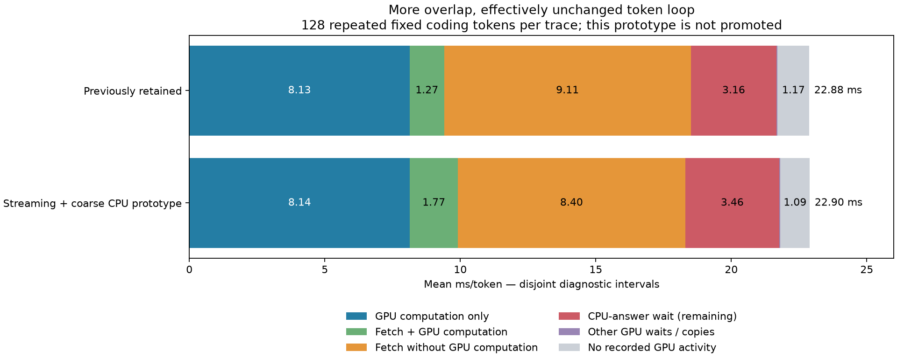

# Maya missing-expert execution campaign

2026-10-13. Branch `research/maya-missing-expert-cost`, preserved baseline `86c6ea0`.

## Decision

**Keep the previously retained configuration. No new generally reliable speed gain was established.** Six complete mechanisms were screened, including targeted combinations. The best small CPU screen did not generalize to repeated 8K occupied context. All new switches remain off by default. Prototypes, tests and negative results are checkpointed; daily settings were not changed and nothing was published. 60 TPS was not reached.

## Fresh controlled comparisons

Same GSQ-RCO 3.0bit Q4-attention pack, c=1, fixed input histories, CPU plan 011223344, 22 GiB expert pool. No speculative tokens, MTP, K4V, skipping or new quantization. Each scored continuation has 128 tokens and two requests after tier warming. TPS is tokens divided by summed forward time. These are short local comparisons, not confidence intervals.

| Workload | Preserved baseline first / repeat TPS | Coarse CPU candidate first / repeat TPS | Repeat change |
|---|---:|---:|---:|
| Short coding | 41.38 / 46.29 | 41.73 / 46.68 | +0.84% |
| 8192 occupied code tokens | 36.40 / 42.15 | 37.36 / 41.79 | -0.86% |

Baseline repeated short TPS varied 45.71→46.29 between the initial and confirmation runs. The candidate confirmation gain is only 0.84%, and the longer-context repeat regresses0.86%. Do not promote the 46.88 initial screen to a sustained performance claim.

| GU streaming alone | Baseline repeat TPS | GU repeat TPS | Change |
|---|---:|---:|---:|
| Short | 46.29 | 46.73 | +0.95% |
| 8K occupied | 42.15 | 41.77 | −0.90% |

The isolated streaming candidate was also qualified rather than inferred from its failed combination. It likewise fails to establish a general gain; both full-logit comparisons are exact.

## Hypothesis and results matrix

| Mechanism | Plausible saving before test | First / repeat TPS screen | Verified engagement / result | Decision |
|---|---|---:|---|---|
| Coarse single-expert CPU executor | At most 1.265 ms exposed single-expert wait | 41.81 / 46.87 | 5605 real coarse batches; full logits exact; short confirmation+0.84%,8K−0.86% | Keep opt-in only |
| Paired gate/up row streaming | Mostly relocates existing overlap; demanded down tail only~0.26 ms | 41.77 / 46.88 | 84 paired prefix copies and 84 GU consumers/token; exact; combined profile flat | Off |
| Four independent mapped-copy loads | Conditional~1.5 ms if concurrent replay bandwidth transfers to inference | 40.83 / 45.82 | Template 4 launch proof in engagement capture; exact bytes/logits; no useful standalone gain | Off |
| Completed 16-route causal reuse | Replay warm 3–5% fewer uploads; first-request regression predicted | 40.00 / 46.13 | 12600 matured anchors; repeat 383→368 MB, first 464→484 MB; hybrid arithmetic placement changes | Reject for retention |
| Exact paired Q2 AVX512 rows | Bounded by CPU wait, does not remove weight bytes | 40.84 / 46.21 | Standalone rows/hidden bytes exact; full-model 39.65M logits exact; diagnostic row counters | Off |
| Delay full CPU admission until down copy completes | Recover contention, bounded by added CPU tail | 41.49 / 46.30 | Same generation published after all down bytes on copy stream; phase callbacks engage; exact | Off |

**The residency run had route logging enabled**, so its TPS is diagnostic. Its byte/correctness results, not a sub-percent timing difference, determine rejection. Other headline screens are unprofiled.

## Dependencies and combinations

- GU bands + coarse CPU: 41.68 / 46.45 TPS, exact. Slower than either isolated screen.
- Coarse CPU + paired Q2 + pipelined copy: 40.82 / 45.39 TPS, exact. No additive gain.
- The existing down transfers already hide almost all gate/up computation on routes with actual demand (only 0.000152 ms/token exposed in the source trace). Exposed all-resident work has no same-layer demand to hide. Moving overlap earlier is not automatically additional saved time.
- The online16 cache policy learns only from fully observed past windows, not an oracle. It reduces warm CPU and upload traffic but adapts poorly initially. Static/mixed predictors and spare reclamation were also bounded by offline replay; these are feasibility evidence, not live performance claims.

## Numerical and prefill results

All scheduling/copy/Q2 experiments compare exactly across 39,649,280 logits in each full short test. Short and 8K coarse-candidate qualification also match all logits and non-timing tier counters exactly. A combined 32-token diagnostic verifies 1344 late phase publications after all demand copies, 2688 launches each of paired-prefix4/down-component4/GU/down, and 2,478,080 exact first-request prefix logits. A separate counter run records 9,263,104 Q2 GU rows and 18,495,360 paired down rows (includes setup). Its second request has a different cache history from the 128-token reference; no second-request parity claim is made. Q2 standalone tests include 96 dot pairs, actual expert dimensions, hidden quantized bytes, clamped/unclamped SwiGLU, misalignment, odd tails and unsupported-format guards.

Online16 hybrid placement differs: max absolute logit difference 3.4219, mean 0.08974, greedy agreement 99.21875%. It is not described as hybrid parity. Controlled GPU-only isolation matches all 9,912,320 logits exactly. This separates backend movement from lost/corrupted ownership; no numerical threshold was weakened.

| 8192-token prefill | Preserved baseline ms | Coarse CPU candidate ms |
|---|---:|---:|
| Request 1 | 3652.595 | 3595.059 |
| Request 2 | 3642.975 | 3566.841 |

Prefill continues through the original batched path. No new candidate is promoted, so there is no fresh lifecycle certification claim for a retained optimization. Normal teardown/repeated requests passed in the experiments. The previous retained candidate keeps its existing STOP/recovery/cold-tier qualification.

## Diagnostic timeline: why more overlap did not win

The following bars partition each token into disjoint observed intervals. They sum to the whole diagnostic loop. GPU compute includes weight reads/dequantization; CPU runs concurrently. These are separate Nsight runs and must not be substituted for unprofiled TPS.

| Stage | Previously retained ms/token | GU + coarse CPU prototype ms/token |
|---|---:|---:|
| GPU computation only | 8.131 | 8.140 |
| Fetch + GPU computation | 1.271 | 1.765 |
| Fetch without GPU computation | 9.107 | 8.399 |
| CPU-answer wait (remaining) | 3.160 | 3.462 |
| Other GPU waits / copies | 0.041 | 0.044 |
| No recorded GPU activity | 1.172 | 1.088 |
| **Total** | **22.880** | **22.898** |

Exposed fetch drops~0.71 ms, but GPU arithmetic and CPU waits grow. The prototype is not a demonstrated profiled speedup. Individual timelines and layer stages are in `combined-trace/`.

## Traffic and memory

| Repeated workload | H2D MB/token, baseline / coarse | D2H MB/token, baseline / coarse |
|---|---:|---:|
| Short | 383.000 / 383.000 | 1.137 / 1.137 |
| 8K | 416.191 / 416.191 | 86.394 / 86.394 |

All main runs retain 2693 GPU slots (21.999 GiB) and 11819 RAM slots (97.822 GiB). Short CPU logical expert payload remains 564.156 MB/token. This is payload accounting, not a DRAM-controller measurement. No extra weight cache or model quantization was introduced.

| Confirmation run | Minimum available system RAM GiB | Whole-device peak VRAM MiB |
|---|---:|---:|
| baseline-confirm | 10.76 | 31106 |
| coarse-confirm | 10.70 | 31099 |
| baseline-8k | 10.75 | 31215 |
| coarse-8k | 10.66 | 31181 |

## Remaining bottleneck and next substantive direction

The retained profile still has~9.1 ms exposed upload,3.16 ms CPU-answer wait and 9.4 ms GPU work (partly overlapping). Same-layer scheduling has little untouched compute to hide. A substantial gain requires useful earlier knowledge/residency or a demonstrably faster joint CPU/upload path; these tests do not establish one. Activation-conditioned value prediction needs causal feature collection and task-disjoint feasibility evidence before implementation as a production policy. Generic frequency admission or adding more overlap launches is not supported by the results.

## Reproduction and checkpoints

`tools/run_missing_costs.py NAME --baseline` uses the preserved executable. Without `--baseline`, the new binary runs the previous retained flags; each new experiment requires an explicit switch. `tools/summarize_three_costs.py NAME --root docs/evidence/maya-missing-costs --reference REFERENCE` produces counters and full-logit comparisons. `tools/build-missing-tests.bat` builds only the two relevant CPU tests.

See `docs/MAYA-MISSING-COSTS-CAMPAIGN.md` and the three missing-expert research notes for mechanisms, safety reviews and negative bounds. Small checkpoints preserve rollback; compact evidence is committed. Large logits, Nsight and SQLite artifacts remain local/ignored. The unrelated `maya-bench.txt` is untouched.
