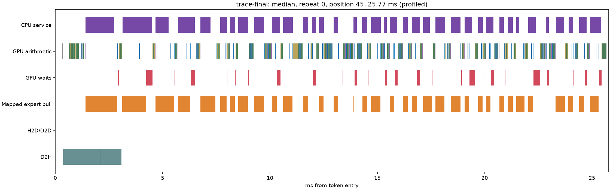
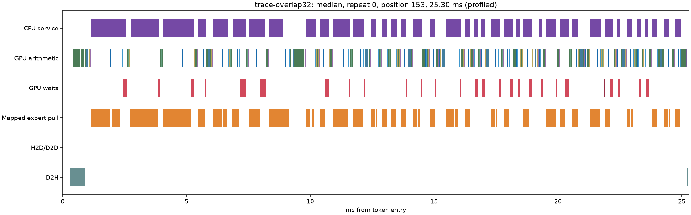

# Maya: focused residency and overlap results

Starting point: retained graph-enabled Maya (`3a4f906`), keeping the prior
RAM-backing/demotion improvements. Same GSQ-RCO 3.0bit Q4-attention packed
weights, c=1, 22 GiB expert pool, no MTP, speculative tokens, K4V, expert
skipping or further quantization. Nothing published. **60 TPS not reached.**

Retained as an opt-in research candidate: causal next-route reuse for eviction,
scored after the CPU answer is published, combined with 32-block down-component
copies restricted to captured recurrent layers. Ordinary fetch remains on
uncaptured layers. Defaults and the daily configuration are unchanged.

## Unprofiled results

Short fixed-input continuation: 30 prompt tokens and 128 scored tokens per
request, first then repeated. Comparison uses a fresh same-day graph baseline.
The experiment sequence was adaptive, one or two targeted cases at a time.

| Path | First TPS | Repeat TPS | Repeat ms/token | Demand MB/token | Demotion MB/token |
| --- | --- | --- | --- | --- | --- |
| baseline | 39.86 | 43.30 | 23.093 | 413.79 | 0.71 |
| transition | 39.97 | 42.72 | 23.410 | 383.00 | 1.14 |
| transition-late | 40.07 | 43.54 | 22.966 | 383.00 | 1.14 |
| transition-overlap | 40.29 | 44.70 | 22.372 | 383.00 | 1.14 |
| overlap-captured | 40.37 | 43.65 | 22.908 | 413.79 | 0.71 |
| combined-captured | 40.70 | 45.20 | 22.122 | 383.00 | 1.14 |

The final combination improves repeated TPS by about 4.4% and reduces repeated demand by 7.4%. Individual mechanisms show much smaller or no reliable throughput gains. Prior run variation was about 4%; these bounded results support a modest candidate, not a precise universal speedup or a large breakthrough.

## Held-out web generation and lifecycle

| Request | Repeat | Tokens | Baseline TPS | Candidate TPS | Same output IDs |
| --- | --- | --- | --- | --- | --- |
| warmup | -1 | 64 | 42.55 | 42.61 | True |
| cancel | -2 | 8 | 44.10 | 47.68 | True |
| recovery | -2 | 32 | 38.07 | 40.01 | True |
| web | 0 | 128 | 37.80 | 39.18 | True |
| web | 1 | 128 | 43.29 | 44.55 | True |

Both sides ran the same warmup, STOP after eight generated tokens, recovery, then two web requests. All generated token IDs matched. The web prompt asks for an HTML/JavaScript bouncing-ball page; generation is capped at 128 tokens, not a completed webapp or quality benchmark. STOP and subsequent request/teardown succeeded. Pooled web throughput improves about 3.3%.

## What was learned and retained

| Mechanism | Evidence | Decision |
| --- | --- | --- |
| Recent-32 frequency | Offline CSV traffic worsened3.4%; writing improved1.2%. | Reject; no production implementation. |
| Causal transition reuse | Live repeat demand413.79→383.00MB; 7,815 changed victim choices in13,272 routes. | Retain opt-in as part of combination. |
| Move reuse scoring after CPU publication | Same measured placement/outputs, repeat42.72→43.54TPS. | Keep dependency; isolate bookkeeping from required answer. |
| Limit overlapping copy blocks to32 | Arithmetic stays near9.1ms instead of prior>11ms; real overlap~0.65ms. | Resource cap useful; all-layer version still pays gaps. |
| Captured-layer-only overlap | Prior added gaps were almost entirely uncaptured work; final combination45.20TPS. | Retain opt-in; ordinary fetch elsewhere. |
| Strata-style admission margin | Source uses gain-filtered/budgeted replacement; Maya admits fetched misses opportunistically. | Future hypothesis, not implemented/measured in this round. |

The transition predictor only ranks eviction victims. It never proactively transfers predicted weights. Training uses observations available so far, with frequency smoothing 16 and per-row aging at 2048 observations. The history persists across requests. This is a limited causal policy, not the future-knowing oracle. Repeated fixtures can reward learned transitions; the held-out web continuation checks some generalization, not broad workload coverage.

## Diagnostic time and overlap

| Profiled FIRST request | Wall ms | Fetch ms | Arithmetic ms | CPU-wait ms | GPU idle ms | Fetch/math overlap ms |
| --- | --- | --- | --- | --- | --- | --- |
| Prior graph baseline | 26.695 | 13.000 | 9.278 | 3.048 | 1.156 | 0.000 |
| Transition before deferred scoring | 26.224 | 12.603 | 9.101 | 3.196 | 1.122 | 0.000 |
| All-layer overlap32 | 26.591 | 12.640 | 9.173 | 3.280 | 1.978 | 0.718 |
| Final combination | 25.841 | 12.576 | 9.238 | 3.361 | 1.147 | 0.683 |

Intervals overlap and are not additive. Profiles are separate from headline TPS; the final capture is one 128-token request, not a repeated warm run. The historical graph trace was recorded earlier and is not a contemporaneous significance test. CPU-wait kernel time is not all removable stall.

| Observed copy grid blocks | Inside captured graph | Kernel executions, including prompt |
| --- | --- | --- |
| 32 | True | 4898 |
| 170 | True | 4898 |

Final capture verifies the intended restriction: all component kernels ran as graph nodes, with 32-block down copies and 170-block prefix copies. Measured first-request fetch/arithmetic overlap is 0.683 ms; GPU inactivity returns to 1.147 ms, near the prior graph-only 1.156 ms. Arithmetic stays near 9.24 ms. The earlier added gap has been removed without reviving the >11 ms arithmetic slowdown.

| Repeated diagnostic | Uncaptured gaps ms | Graph-boundary gaps ms | Inside-graph gaps ms |
| --- | --- | --- | --- |
| maya-demand/trace-graphs | 0.877 | 0.154 | 0.097 |
| maya-residency-overlap/trace-overlap32 | 1.653 | 0.157 | 0.090 |

## Numerical, prefill and ownership checks

| Case | Logits compared | Exact | Maximum absolute difference | Top1 agreement |
| --- | --- | --- | --- | --- |
| combined-captured | 39649280 | False | 5.314372 | 98.83% |
| gpu8k-candidate | 19824640 | True | 0.000000 | 100.00% |
| overlap-captured | 39649280 | True | 0.000000 | 100.00% |

| Controlled GPU-only, 8K occupied | Prefill ms | Input tokens/s | Ownership check |
| --- | --- | --- | --- |
| gpu8k-baseline | 3743.56 | 2188.3 | True |
| gpu8k-candidate | 3560.63 | 2300.7 | True |

GPU-only comparison uses the same backend for every required expert and matches every compared logit exactly. Q2_K/Q3_K/Q4_K packed expert bytes are unchanged. Normal hybrid placement differs numerically: the residency policy changes CPU/GPU assignment and can change subsequent routes even with fixed input tokens. All scheduling variants of that same residency policy produced identical compared logits to one another. No parity threshold was weakened. This is not a claim of exact hybrid parity. The targeted 8K check found no prefill regression; its single timing pair is not evidence for a prefill optimization.

## Memory, limitations and PR scope

| Case | Expert pool GiB | Pinned tier GiB | Minimum free physical GiB |
| --- | --- | --- | --- |
| baseline | 22.00 | 97.82 | 12.49 |
| combined-captured | 22.00 | 97.82 | 12.52 |
| gpu8k-candidate | 22.00 | 97.82 | 12.30 |

The transition tables add roughly 15 MiB of ordinary host memory, with no extra expert slots or background uploads. GPU clocks/thermal samples are stored alongside fixed runs; clocks were not locked and minor differences remain uncertain. CUDA/NVIDIA c=1 was built and exercised. AMD, multi-GPU and speculative/concurrent integration are unqualified. The history policy should be reviewed for those future paths separately.

Research branch: `research/maya-residency-overlap`. Checkpoints:
`85385a4` initial prototypes, `e765b0c` CPU-answer ordering,
`19dd065` captured-layer restriction, `276a0aa` combined candidate/teardown.
Baseline rollback: `3a4f906`. Implementation remains opt-in in
[maya-residency-overlap.json](../../../../configs/maya-residency-overlap.json).
Retained implementation/configuration checkpoint: `32821bc`.

PR-facing changes are the reuse policy helper and integration, bounded
component-copy kernel/fork-join, and teardown ordering. Keep experimental
tools/evidence separate during PR preparation. No PR was opened or published.
The detailed [audit](../../../MAYA-RESIDENCY-OVERLAP.md) preserves failed ideas,
dependency findings and source references. Remaining demand is still 383 MB/token;
neither smarter eviction nor overlap has removed the dominant transfer cost.
