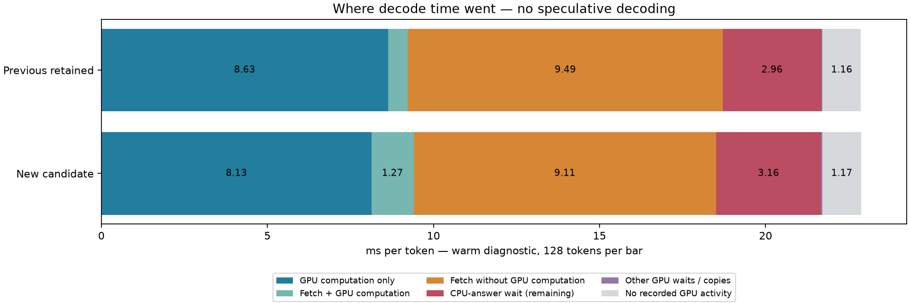

# Maya three-costs campaign — results

2026-10-13. Branch `research/maya-three-costs`; measured retained baseline preserved at `4f2f6e8`. No external publication.

## Confirmed performance

Identical GSQ-RCO 3.0bit Q4-attention packed weights, c=1, fixed input histories, fixed CPU plan, 22GiB expert pool. No MTP, speculative tokens, K4V, skipping or new quantization. TPS is scored tokens / summed forward time. First means first request after tier warming, not disk-cold startup.

| Workload | Baseline first / repeat TPS | Candidate first / repeat TPS | Repeat change |
|---|---:|---:|---:|
| Short coding continuation | 40.47 / 44.36 | 40.72 / 45.90 | +3.47% |
| 8192 occupied code tokens | 36.38 / 40.82 | 37.61 / 42.25 | +3.51% |

Each continuation has 128 scored tokens, two requests. The fresh short baseline 44.36 differs from the initial 43.83 screen; individual sub-percent improvements are not established. The gain is modest and 60 TPS was not reached.

## Hypotheses, supporting combinations and decisions

| Mechanism | First / repeat TPS | Result |
|---|---:|---|
| Dense Q4 activation reuse | 40.01 / 42.62 | Reject: dense Q4 time ~3.21→3.18ms; no useful whole-loop gain |
| Earlier CPU answer | 40.21 / 44.41 | Retain in combination; answer precedes cache bookkeeping; stable request snapshot |
| Windows spin PAUSE | 40.55 / 44.75 | Retain in combination; same fences and time budgets |
| Resident GU during prefix fetch | 38.38 / 42.93 | Reject: measured overlap rose, arithmetic and CPU tail grew; diagnostic TPS |
| Down row streaming + resident GU | 40.88 / 45.56 | Dependency experiment: resident split unnecessary |
| Down row streaming without resident split | 40.42 / 45.71 | Retain: exact row ordering, each byte copied once |
| CPU expert-ready tasks | 38.51 / 43.11 | Alone not helpful; retain only with phase schedule; diagnostic TPS |
| CPU prefix-phase gate | 40.60 / 45.06 | Retain in combination; verified gated callbacks, not core affinity |
| Warp top-k/cooperative publication | 40.98 / 44.14 | Small route-stage saving; retain in combination |
| MLA MoE suffix capture | 41.53 / 45.82 | Retain graph infrastructure; isolated speed increment within variation |
| HC normalization stage split | 39.98 / 44.83 | Reject: exact but extra nodes/reads outweigh removed barriers |
| Full scheduler/GPU combination | 41.60 / 46.49 | 46.49 was a screen, not the confirmation result |
| Single-expert CPU pipeline coverage | 41.26 / 46.07 | Reject extension: engaged but no extra gain |
| Same GPU combination without CPU schedule | 41.76 / 45.53 | Ablation: CPU schedule helps the combined path |

Dependency findings: down bands do not need resident-GU splitting. The CPU task pipeline needs phase-aware scheduling to help this combination; broader single-expert coverage did not improve it. Suffix capture enables component overlap without uncaptured event submission. Routing publication advances CPU work but does not remove payload bytes. Combined benefits are not additive. Detailed CPU-stage NVTX spans in early diagnostic runs add overhead; final diagnostics disable those optional spans.

## Prefill and numerical qualification

| 8192-token prefill | Baseline ms | Candidate ms |
|---|---:|---:|
| Request 1 | 3660.619 | 3552.421 |
| Request 2 | 3561.222 | 3558.099 |

`candidate-confirm`: 39,649,280 logits; exact=True; max absolute difference=0.0; greedy agreement=100%.

`candidate-8k`: 39,649,280 logits; exact=True; max absolute difference=0.0; greedy agreement=100%.

`retained-trace`: 39,649,280 logits; exact=True; max absolute difference=0.0; greedy agreement=100%.

Mixed Q2_K/Q3_K/Q4_K experts are exercised by the model. Full logits are compared, not just sampled tokens. Tier counters and bytes agree for matched inputs. Route masks are separately checked from diagnostic traces; no claim that aggregate hit counts alone prove routing equivalence.

## Capacity and traffic

| Repeated workload | Baseline H2D MB/token | Candidate H2D MB/token | Baseline/candidate D2H MB/token |
|---|---:|---:|---:|
| Short | 383.000 | 383.000 | 1.137 / 1.137 |
| 8192 occupied | 416.191 | 416.191 | 86.394 / 86.394 |

Both retain 2693 GPU slots (21.999 GiB) and 11819 RAM slots (97.822 GiB). Long prefill lends/reclaims the cache and produces more subsequent demotions; short repeated demotion elimination must not be generalized to that lifecycle. Short CPU expert logical payload remains 564.156 MB/token; payload accounting is not measured physical DRAM traffic.

| Run | Minimum system RAM available GiB | Peak GPU allocation MiB (whole device) |
|---|---:|---:|
| baseline-confirm | 10.24 | 31021 |
| candidate-confirm | 10.31 | 31026 |
| baseline-8k | 10.13 | 31103 |
| candidate-8k | 10.16 | 31102 |

GPU memory includes foreground/driver allocations; profiler runs are separate and can use additional memory. Hardware logs preserve clocks, power and temperature; this is a local short qualification, not a population confidence interval.

## Diagnostic token timeline

The bars are disjoint interval unions and sum to elapsed token time. Fetch and computation overlap is counted once. These diagnostic loops exclude output-logit readback/harness overhead; use the unprofiled table for TPS.

| Warm diagnostic stage | Previous retained ms/token | New candidate ms/token |
|---|---:|---:|
| GPU computation only | 8.629 | 8.131 |
| Fetch + GPU computation | 0.594 | 1.271 |
| Fetch without GPU computation | 9.494 | 9.107 |
| CPU-answer wait (remaining) | 2.956 | 3.160 |
| Other GPU waits / copies | 0.042 | 0.041 |
| No recorded GPU activity | 1.156 | 1.172 |
| **Total** | **22.871** | **22.880** |

Individual median/fast/slow token timelines and layer-local component timings are in `retained-trace/`. The baseline is the previously retained diagnostic with identical slots/payloads, not an unprofiled run.

The profiled total is effectively unchanged, despite the unprofiled improvement. More overlap is proven, but increased arithmetic duration, fetch duration and CPU waits consume it in this trace. Added graph nodes and profiler sensitivity prevent assigning the full unprofiled saving to a particular stage. Do not present the diagram as proof of a net profiled speedup.

## Lifecycle and held-out generation

The current binary was tested with retained-baseline flags and with candidate flags on the same warmup → STOP after eight tokens → recovery → web-generation sequence. RAM shadow ownership verification was enabled for both. Cancellation reported cancel, recovery completed, QUIT exited cleanly, and every output token ID matched. This is a same-binary flag ablation, separate from the preserved-binary fixed-input comparisons above.

| Held-out free generation | Control TPS | Candidate TPS | Interpretation |
|---|---:|---:|---|
| Web page, 128 tokens | 38.78 | 39.01 | +0.59%; too small to establish a reliable gain from one run |

All 10,752 diagnostic layer-route mask records match exactly (fetch, CPU, disk-miss, promotion masks and blob bytes in token/layer order). Those marks do not contain expert IDs; full-logit equality supplies the complementary numerical check. See `route-validation.json` and `lifecycle-validation.json`.

Cold-tier qualification disabled tier warming and exercised 761 actual disk reads over the scored 16-token continuation. All 2,478,080 logits and all non-timing per-token counters matched the preserved baseline. That cold configuration selected zero CPU experts, so it qualifies disk ownership/stream readiness rather than CPU scheduling. Warm hybrid qualification is provided by the short and 8K comparisons. See `cold-validation.json`.

Mechanism proof: the retained trace has 42 optimized router launches, 42 prefix copies, 84 down-band copies, 84 down consumers and 42 prefix-ready publications per token. Overlap is measured by interval intersection. Unprofiled counters recorded 51,621 gated callbacks in the confirmation run. The rejected HC trace has 68 launches of each split phase per token and exact prefix logits; its phase2 alone takes about 0.97 ms, explaining why removing spin barriers did not help.

## Reproduction and rollback

`tools/run_three_costs.py NAME --candidate` selects the retained configuration. Add `--occupied 8192` for the corpus fixture, or `--trace` for diagnostics. `--baseline` uses the preserved pre-campaign executable. All mechanisms remain opt-in; rejected prototypes remain checkpointed for audit, not enabled in the selected configuration.

Research bounds, source reviews, implementation rationale and checkpoints are recorded in `docs/MAYA-THREE-COSTS-CAMPAIGN.md` and the three linked research reports. No residency or capacity improvement is credited to this campaign. Remaining costs are host-memory expert traffic, its contention with CPU expert work, exposed CPU completion, and GPU arithmetic preceding the route. Reaching 60 TPS needs substantially more than this measured scheduling gain.
