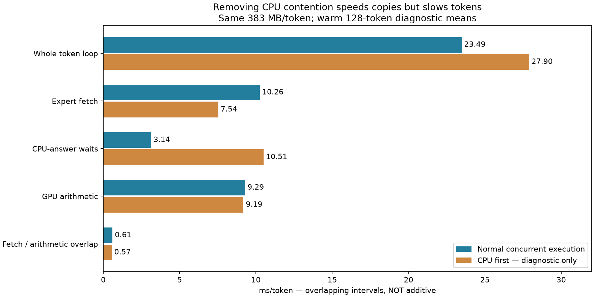
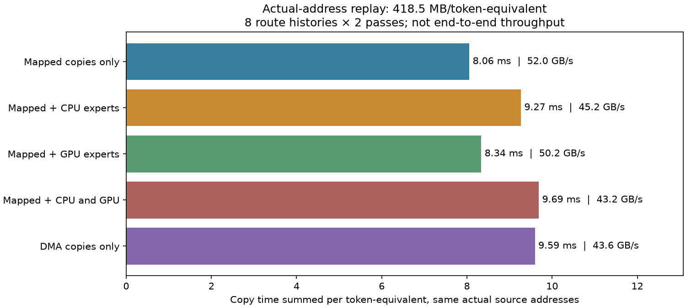

# Why live Maya transfers lose bandwidth

2026-10-13. Branch `research/maya-transfer-attribution`, starting at `eca6b16`.
Same GSQ-RCO 3.0bit Q4-attention pack, c=1, no speculative tokens or K4V.
One fixed-input CSV workload, first and repeated request. No external publication.

**Main result: concurrent CPU expert work explains most of the live mapped-copy
bandwidth deficit. Removing the overlap restores roughly 51 GB/s, but slows
the token loop. Keep normal concurrency.** No performance setting changed.

## Live causal ablation

Added opt-in `MAYA_PROBE_CPU_FIRST=1`: after routing, wait for the SAME CPU
expert computation before fetching weights. The readiness-only call uses zero
output elements; the usual end-of-layer call adds the CPU result exactly once.
No expert is skipped, no assignment changes, and all routes/tier counters match.

| Warm diagnostic, 128 scored tokens | Normal execution | CPU first |
|---|---:|---:|
| Demand MB/token | 383.000 | 383.000 |
| Fetch interval union ms/token | 10.263 | 7.542 |
| Effective useful-payload GB/s | 37.32 | 50.78 |
| CPU-answer wait kernel ms/token | 3.140 | 10.508 |
| GPU arithmetic union ms/token | 9.294 | 9.185 |
| Fetch/arithmetic overlap ms/token | 0.608 | 0.570 |
| Whole token wall ms | 23.495 | 27.900 |

CPU-first removes **2.721 ms of fetch time**, but adds **4.405 ms to token
wall time**. CPU wait intervals are not all additive/exposed; removing CPU/GPU
concurrency increases the exposed dependency substantially. Hardware and
profiling timings vary; treat magnitudes as approximate, not universal constants.

The baseline is the saved recent warm diagnostic (`maya-deep-profile/warm-detail`),
not stock Maya and not unprofiled throughput. Identical forced inputs, cache sizes,
placement counters, fetch bytes and logits provide the attribution controls.
GPU memory clocks logged about 16.9 GHz in that baseline versus 16.7 GHz in these
new runs; the small clock difference is a limitation, not an explanation for the
large recovered host-transfer bandwidth. No clocks or power settings were changed.

This establishes the effect of concurrent CPU expert work. It does not separate
DRAM controller bandwidth, CPU-cache/coherence or fabric effects with hardware
counters. The collective host-memory path is implicated; claiming an exact
physical DRAM-stall breakdown would exceed the evidence.

## Actual-address replay

The new `MAYA_TRANSFER_PROBE=1` recorder retains the last eight tokens' 336
layer requests. Records include actual pinned source addresses, resident GPU
addresses, selected CPU experts, input vectors, format and component sizes.
The model stays allocated. Replay writes private GPU buffers, never live model
weight destinations. It waits for GPU/service completion and validates owned
RAM slot boundaries. All model allocations stay alive until replay finishes.

CUDA graph replay uses the real mapped-copy kernels with 170-block prefix and
32-block down copies. GPU contention uses actual routed gate/up/down kernels,
and CPU contention calls the existing CPU expert implementation. GPU globaltimer
stamps measure transfer intervals; readback verifies bytes outside timing.

| Replay mode | MB/token-equivalent | Copy ms | Effective GB/s |
|---|---:|---:|---:|
| Mapped copies alone | 418.48 | 8.055 | 51.95 |
| Plus recorded CPU experts | 418.48 | 9.266 | 45.16 |
| Plus routed GPU expert computation | 418.48 | 8.336 | 50.20 |
| Plus both | 418.48 | 9.686 | 43.21 |
| DMA copies alone | 418.48 | 9.595 | 43.61 |

These are the last eight tokens, whose traffic exceeds the whole warm request's
383 MB mean. All modes use identical addresses and byte counts. Two scored passes
per layer after one warm-up. Compare within this table; do not confuse replay time
with full token latency. CPU modes vary between passes: copy+CPU 9.77/8.77 ms,
copy+CPU+GPU 10.12/9.26 ms. Small precise percentage claims are not justified.

On those same final eight live token positions, normal fetch time was 11.104 ms;
CPU-first was 8.258 ms. The latter agrees closely with copy-only actual-address
replay at 8.055 ms. This bridges replay and the full-engine observation.

RAM slot contents may have been reused after the original route, but source
allocations/addresses and formats remain valid. Replay compares copies with their
current bytes, not a claim of reproducing previous expert answers. GPU replay
excludes attention/shared expert computation. Routes without a CPU input use a
fixed activation for GPU work. Warm cache state, submission order, clocks and
private destination placement also differ from live inference. These explain why
replay is an isolation tool, not an exact full-engine replica or TPS benchmark.

DMA's bulk-copy advantage did not survive this replay design. That is not proof
that a complete demand-aware DMA implementation cannot help: graph copy-node
submission, multiple expert copies and scheduling differ from a contiguous bulk
copy. Do not reintroduce the previously rejected integrated DMA path based on a
microbenchmark alone.

## What is ruled out or supported

| Explanation | Evidence / verdict |
|---|---|
| Runtime expert packing | Absent in the warm fetch path; packed bytes are already in RAM. |
| Large allocated RAM tier or scattered addresses alone cap transfers at 37 GB/s | Rejected for these traces: real-address replay in the 97.82 GiB tier reaches 51.95 GB/s. |
| CPU expert co-execution | Strongly supported: both replay and live ablation reduce bandwidth while CPU work overlaps. |
| GPU expert co-execution | Smaller effect in bounded replay; not ruled out generally. Actual full-engine no-CPU-overlap path remains near 51 GB/s. |
| Slow consumption after arrival | Earlier and new traces show about one microsecond; not the missing milliseconds. |
| Missing layer streaming | Already streams per layer and overlaps down copies. No all-model loading barrier. |
| Just use DMA | Not established: 43.6 GB/s in the actual-address replay versus 52 mapped. |

## One practical mitigation check

Reduced CPU lane from 16 to 8 workers while preserving the fixed assignment plan
`011223344` and ordinary concurrency. Engine log confirms eight workers, all tier
counters and generated logits remain unchanged.

| Unprofiled fixed-input run | First TPS | Repeated TPS |
|---|---:|---:|
| Retained candidate, earlier reference | 40.70 | 45.20 |
| 16 workers, new run with address recording | 39.55 | 44.92 |
| 8 workers, new run without recording | 40.45 | 45.10 |

These are within observed variation; the recording flag also adds a small CPU
copy to the middle row. No evidence of a useful gain, so retain 16 workers. Do
not claim prefill improvement: only short prompts ran; no production performance
change was retained that would justify broader prefill qualification here.

## Validation, failures, checkpoints

- Replay and CPU-first each match **39,649,280 logits exactly**, max error zero,
  against the retained candidate. Eight-worker run also matches exactly.
- Live CPU-first byte/tier counters match on all 256 scored inputs.
- Replay CSV has all 3,360 expected scored records. Mode signatures and last-eight
  demand bytes reconcile with the live CSV. All actual transfer readbacks passed.
- All Q2_K/Q3_K/Q4_K expert classes remain present. No weight representation,
  arithmetic, expert requirements, cache policy or ownership algorithm changed.
- First attempt (`replay/`) failed because captured dependency events did not
  support elapsed-time queries. Preserved as a failed measurement attempt;
  GPU timestamp implementation in `replay-stamps/` completed successfully.
- Capture-status-aware cleanup joins GPU work before freeing replay resources.
  HIP receives an explicit unsupported diagnostic result; no HIP qualification.
- Checkpoints: `3d292f7` initial actual-address recorder/replay; `1724b05` timestamp
  measurement, live ablation and cleanup. Final source builds successfully.
- Baseline executable preserved locally as `maya_transfer_lab_pre_attribution.exe`.
  Normal config remains unchanged. Model processes exited; GPU released.

## What to pursue next

1. Reduce host-memory demand, including **both GPU-fetched and CPU-executed expert
   bytes**. Better residency can reduce contention as well as PCIe byte count.
   Moving a miss from GPU to CPU is not automatically a bandwidth reduction.
2. Investigate finer-grained scheduling only when it preserves overlap and
   reduces exposed completion time. Blanket CPU-first serialization is rejected.
3. A transfer implementation must be tested against this concurrent workload,
   not just a bulk-copy test. Approximately 52 GB/s without CPU competition is
   already attainable; an isolated peak is not free end-to-end headroom.

At 383 MB, theoretical Gen5 x16 requires 6.078 ms, isolated mapped capability
about 7.37 ms, and live CPU-first 7.54 ms. Those are different comparison cases,
not separate additive physical stages. Reducing bytes and contention together
could exceed a 2.9 ms benefit, but no such combined gain has been measured here.

Tools: `analyze_deep_profile.py`, `summarize_transport_probe.py`,
`report_transfer_attribution.py`. Manifests preserve model/binary hashes and flags;
large raw SQLite/logit artifacts stay local, with summaries and plots committed.
