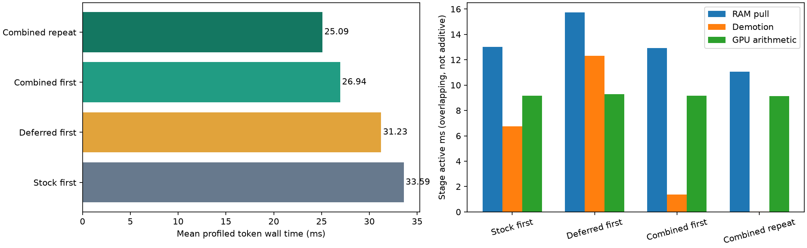
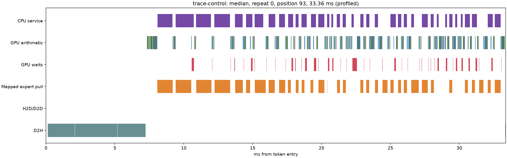
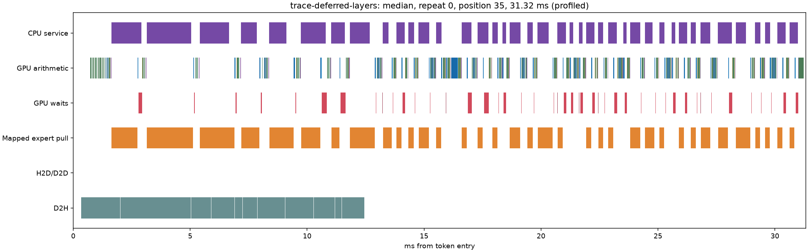
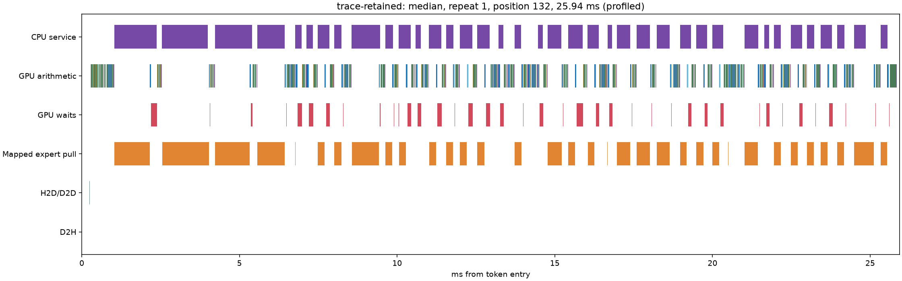

# Maya transfer campaign: results

Eight distinct mechanisms were experimentally evaluated. The retained combination is bounded immutable RAM backing plus demotion submission after the embedding upload. This removes copy-back traffic instead of trying only to accelerate it. **60 TPS was not reached.** No changed arithmetic kernels, token speculation, MTP, K4V, expert skipping or new quantization are in the retained implementation.

The same GSQ-RCO 3.0bit Q4-attention pack was used throughout. The routed weights contain Q2_K, Q3_K and Q4_K (GGML types 10/11/12). c=1; GPU expert pool cap 22 GiB; 2,693 GPU slots; CPU plan 011223344 unless an ablation explicitly changes it. CPU/GPU/hardware clocks were not locked; these are bounded paired screens, not confidence intervals from independent repeated sessions.

## Controlled fixed-input decode

128 saved input tokens per request, two repetitions in one process. First means first scored request after tier warmup, not disk-cold. Repeat benefits from cache adaptation. Short prompt: 30 occupied tokens; long prompt: 8,192 occupied tokens from frozen source code, followed by the same continuation. Context capacity is 131,072, distinct from occupancy. Host logits download is included, output-file writing excluded. No diagnostic CUDA profiler in these timings.

| Fixture | Stock TPS | Candidate TPS | Ratio | Mean ms/token | p95 ms/token |
| --- | --- | --- | --- | --- | --- |
| Short, first | 30.52 | 38.19 | 1.251x | 32.77 → 26.19 | 38.68 → 30.56 |
| Short, repeat | 33.03 | 40.96 | 1.240x | 30.28 → 24.42 | 36.33 → 29.41 |
| 8K, first | 28.90 | 35.52 | 1.229x | 34.60 → 28.15 | 39.77 → 35.74 |
| 8K, repeat | 30.40 | 37.27 | 1.226x | 32.90 → 26.83 | 37.26 → 31.01 |

The 8K and diagnostic traces use the pre-cleanup candidate; the short and free-generation qualification uses the cleaned build. Binary hashes are saved per run. Cleanup removed disabled DMA/resident-gate prototypes and restored stock kernels. All 39,649,280 hybrid logits before/after cleanup are bit-identical (cleanup-parity.json). Original pre-cleanup short result: 38.90 / 42.61 TPS. The cleaned repeat is ~4% slower despite identical outputs/traffic, demonstrating run variation; do not interpret the small short-context H3-on-H1 increment as statistically established. H3 has clearer standalone and 8K evidence, so it remains in the candidate.

## Free generation on the cleaned build

Greedy CSV/Python, explanation and HTML/JavaScript prompts, 128 output tokens each, two requests per task after warmup. Different outputs/routes are allowed here; fixed-input tests above control that confounder. These are short throughput workloads, not a webapp-completion quality benchmark.

| Task, pooled over two requests | Stock TPS | Candidate TPS | Ratio |
| --- | --- | --- | --- |
| csv | 28.54 | 36.43 | 1.277x |
| explanation | 30.70 | 39.20 | 1.277x |
| web | 28.48 | 36.33 | 1.276x |

## Hypotheses, engagement and decisions

| Hypothesis | First/repeat TPS | Verified mechanism | Decision |
| --- | --- | --- | --- |
| H1: RAM backing | 37.43 / 41.24 | Actual copies eliminated; mixed-format bytes and ownership checked | Retain expanded backing. +10.49 GiB pinned RAM; limited 4 GiB backing gained only ~4%. |
| H2: reuse admission | 32.73 / 34.92 | Promotion/D2H counters decrease | Do not add to retained combination; full-cpu-admission loses first-request speed. |
| H3: deferred demotions | 34.34 / 37.00 | Actual D2H/arithmetic overlap 2.33 ms/token; exact logits | Retain layers scheduling. Table-publication-only attempt was neutral. |
| H4: resident gate/up overlap | 29.74 / 31.52 | 1.04 ms/token actual fetch/arithmetic overlap; exact logits | Reject this implementation: extra arithmetic launches and GPU gaps outweigh overlap. |
| H5: DMA transport | 29.93 / 32.26 | Byte-exact microbenchmark 57–58 GB/s vs pull 45–53; integrated DMA bytes counted | Reject integrated DMA and overlap: 29.93/32.26 TPS. DMA-only first request 30.41 TPS. |
| H6: next-layer prediction | 34.51 / 36.53 | Useful predicted bytes measured; repeated useful fraction ~63.5% | Reject tested policy: excessive total H2D even with RAM backing. |
| H7: lossless compression | Feasibility only | All sampled matrices roundtrip exactly; LZ4 ratio .9712, Zstd .9332 | Reject CPU transport (3.52/1.83 GB/s decompression); GPU codec not built, small optimistic byte benefit. |
| H8: CPU assignment | 31.92 / 35.38 | Lower transfer demand, CPU execution counters engaged | Do not add to expanded backing; full-cpu 36.70/41.05 TPS is not better. |

Each experiment's manifest, counters and notes are preserved in the parent directory. Bounds, dependencies, risks and falsifiers were written before implementation in [campaign plan](../../../MAYA-TRANSFER-CAMPAIGN.md); public/local sources and intermediate decisions are in [research](../RESEARCH.md). Rejected screens were not all taken through long-context/prefill and Nsight qualification: those expensive metrics were reserved for promising mechanisms/complete combinations, not inferred from their flags. H7 is a measured feasibility rejection, not a claim all compression is impossible.

## Dependencies and ablations

H1 → eliminates most D2H; H3 → overlaps remaining D2H. H2 and H8 → reduce transfer demand, but compete with gains already supplied by H1. H4 → requires independent transfer progress; H5 supplied DMA, but the complete combination still lost. H6 → relies on accurate/timely predictions and cheap transfers; H1 removes copy-back overhead but cannot remove wasted prediction uploads. H7 → needs sufficient byte savings plus fast decompression before integration is justified.

| Combination/ablation | First / repeat TPS |
| --- | --- |
| combo-policy | 33.15 / 36.16 |
| combo-no-shadow | 32.98 / 36.12 |
| shadow-complete | 37.43 / 41.24 |
| full-cpu | 36.70 / 41.05 |
| full-cpu-admission | 34.56 / 41.00 |
| dma-overlap | 29.93 / 32.26 |
| full-transfer | 36.74 / 40.09 |
| full-predict | 34.51 / 36.53 |
| retained-short | 38.90 / 42.61 |

## Transfer traffic and capacity

Decimal MB/token; no speculative prediction in retained candidate. Demand counters measure complete fetched blobs. Trace-control is instrumented stock scheduling; its workload/slot count matches the first short fixture. Stock v2 has no byte counters, so its zero placeholders are not reported as zero traffic.

| Run / repeat | Demand H2D | D2H | Predicted H2D | Useful prediction | GPU hits/token | CPU experts/token | Disk reads/token |
| --- | --- | --- | --- | --- | --- | --- | --- |
| trace-control / 0 | 466.93 | 382.30 | 0.00 | 0.00 | 213.7 | 70.2 | 0.00 |
| deferred-layers / 1 | 403.48 | 339.77 | 0.00 | 0.00 | 228.6 | 62.5 | 0.00 |
| retained-clean / 0 | 472.86 | 50.02 | 0.00 | 0.00 | 214.6 | 70.9 | 0.00 |
| retained-clean / 1 | 413.79 | 0.71 | 0.00 | 0.00 | 228.9 | 63.6 | 0.00 |
| retained8k-corpus / 0 | 520.88 | 129.91 | 0.00 | 0.00 | 203.3 | 76.6 | 0.00 |
| retained8k-corpus / 1 | 470.92 | 106.36 | 0.00 | 0.00 | 214.9 | 70.5 | 0.00 |
| full-predict / 1 | 228.01 | 14.30 | 591.58 | 375.87 | 271.4 | 41.7 | 0.00 |

Deferred-layers retains stock placement and exact stock logits; its repeat counters provide the scheduling-only reference (403.51 MB demand + 339.78 MB demotion/token). Candidate repeat is 413.79 + 0.71 MB/token: demand is slightly higher, but total bidirectional expert traffic is about 44% lower. Copy-back drops ~99.8%. Counters describe bytes submitted during the scored window; traces separately account for copies crossing token boundaries.

Stock pinned expert RAM: **87.33 GiB**; candidate: **97.82 GiB** (+10.49). Same **22.00 GiB GPU expert pool**. These are expert allocations, not total process/GPU usage. A 24 GiB duplicate budget is a retention limit inside the RAM tier, not an additional 24 GiB allocation. Windows pinning fallback reduced one class's allocation; not every weight has two copies. The candidate preserves headroom checks and logs actual capacity. Prefill lending releases duplicate backing when needed; this explains why repeated long prompts still cause more demotions than repeated short prompts.

| Run | Minimum physical RAM available, GiB | Minimum commit available, GiB |
| --- | --- | --- |
| retained-clean | 13.40 | 24.50 |
| retained8k-corpus | 10.17 | 21.02 |
| trace-retained | 8.62 | 21.31 |

## Diagnostic token timelines

GPU timestamp interval unions/intersections, not CPU enqueue durations. Stage times overlap and **must not be summed**. D2H-minus-arithmetic-overlap still includes overlap with pulls, so it is not a causal exposed-latency estimate. The wall-time difference measures net removal/overlap including contention. Profiler RAM overhead is recorded separately; GPU slot count stays 2,693. These diagnostic timings are not the unprofiled TPS table.

| Trace | Wall | Expert fetch | D2H | Arithmetic | D2H∩arithmetic | CPU∩arithmetic | No GPU activity |
| --- | --- | --- | --- | --- | --- | --- | --- |
| trace-control | 33.591 | 13.022 | 6.766 | 9.154 | 0.000 | 0.950 | 1.942 |
| trace-deferred-layers | 31.230 | 15.724 | 12.308 | 9.299 | 2.333 | 0.961 | 1.721 |
| trace-retained / 0 | 26.942 | 12.919 | 1.365 | 9.152 | 0.447 | 0.984 | 1.873 |
| trace-retained / 1 | 25.095 | 11.052 | 0.014 | 9.137 | 0.006 | 1.103 | 1.952 |









Demotion scheduling alone makes copies last longer (bandwidth contention) but overlaps them, reducing wall time. Backing removes the work instead. Once warmed, fetch remains ~11.05 ms and GPU arithmetic ~9.14 ms; serial dependency, CPU answer waits and host gaps remain. Reaching 60 TPS requires a <=16.67 ms loop and thus another substantial change; the present results do not establish it.

## Prefill and correctness

| 8,192 occupied-token prompt | First prefill ms | Repeat prefill ms |
| --- | --- | --- |
| baseline8k-corpus | 3563.05 | 3562.62 |
| shadow8k-corpus | 3551.80 | 3545.83 |
| retained8k-corpus | 3488.56 | 3479.68 |

Measured 8K prefill is preserved (about 3.56 s stock vs 3.48 s retained). This is a two-request fixture, not proof at every prompt length. An earlier 16K test used the wrong forward API and was stopped/excluded; corrected driver uses batched prefill followed by the last-token forward. Same corrected driver on the unchanged stock engine supplies the 8K baseline.

Scheduling-only H3 compares all 39,649,280 logits exactly. Original resident-overlap and completed DMA-only tests also match exactly. RAM-backing ownership is isolated using a GPU-only plan; cold loading and per-class byte checks verify immutable copies independently of CPU/GPU arithmetic placement. No numerical threshold was loosened.

| Fixed-input test | Reference | Positions | Bit exact | Max absolute delta | RMS delta | Top-1 agreement |
| --- | --- | --- | --- | --- | --- | --- |
| deferred-layers | fixed-baseline | 256 | True | 0.00000 | 0.00000 | 100.00% |
| gpu-clean-cold | gpu-baseline | 128 | True | 0.00000 | 0.00000 | 100.00% |
| gpu-cold-shadow | gpu-baseline | 128 | True | 0.00000 | 0.00000 | 100.00% |
| gpu-shadow | gpu-baseline | 128 | True | 0.00000 | 0.00000 | 100.00% |
| retained-clean | fixed-baseline | 256 | False | 3.50764 | 0.14019 | 98.83% |
| retained8k-corpus | baseline8k-corpus | 256 | False | 3.46416 | 0.16083 | 99.61% |

**Hybrid bit-exact parity is not claimed.** Retaining backing changes placement and therefore CPU/GPU assignment. Stock itself changes logits across repeated cache states (max 3.877, RMS .1382; 98.44% top-1 agreement). GPU-only exact comparisons isolate memory/ownership correctness; restoring unchanged arithmetic kernels and exact H3 tests isolate scheduling. This supports retaining the engineering change, but does not turn hybrid numerical differences into a bit-exact parity pass or a broad model-quality guarantee.

| Lifecycle request | Completion |
| --- | --- |
| warmup | DONE 64 13 485.0 1589.0 length 0 0 0 14785 21168 |
| cancel | DONE 8 15 396.1 182.7 cancel 0 0 0 1453 2352 |
| recovery | DONE 32 16 384.1 853.8 length 0 0 0 6072 10416 |

Successful process exit checks QUIT/teardown after STOP and recovery. Every 64 diagnostic boundaries, dual-owner mappings are checked and a complete GPU/RAM expert payload is compared per live quant class. Representative short/8K repeated requests exercise eviction pressure and prefill lending; deliberately cold GPU-only execution exercises disk demand. This does not certify all multi-GPU/AMD configurations or untested speculative paths.

## Retained implementation and rollback

Branch: `research/maya-transfer-campaign`. Baseline: `615973d` / preserved reproduction branch. All prototypes remain at `research/maya-transfer-prototypes` (`3cf31ef`). Retained cleanup checkpoint: `84c4f17`. Separate unchanged-engine baseline worktree/driver: `research/maya-transfer-baseline-tools` (`4bf9d4c`). No external publication.

Opt-in candidate settings (stock behavior remains available with these MAYA settings unset):

```text
STRATA_GLM_NO_MTP=1
STRATA_GLM_CPU_PLAN=011223344
STRATA_GLM_POOL_GB=22
STRATA_GLM_RAM_GB=101
STRATA_GLM_USAGE=0
MAYA_RAM_SHADOW_MB=24576
MAYA_RAM_SHADOW_EXPAND=1
MAYA_DEFER_DEMOTIONS=layers
```

The headroom-limited RAM budget is not a guarantee that every foreground workload fits simultaneously. Use the logged allocation and available-memory record. The standard daily launcher/config was not silently changed.

Reproduce via `tools/run_transfer_lab.py`, `tools/profile_decode.py`, `tools/validate_retained_transfer.ps1`; summarize via `tools/summarize_transfer.py` then `tools/report_transfer_campaign.py`. Evidence includes manifests, per-token CSVs, memory samples, logits locally, CUDA traces locally, exported timing tables, request outputs and failure logs. Rejected prototype flags require the prototype branch. Large logits/traces are retained locally and intentionally not committed.

Next bottleneck is demand RAM→VRAM traffic and dependent compute, not bulk warm copy-back. Revisit prediction only with materially better usefulness/demand priority; revisit overlap only with lower submission/launch cost. More RAM duplication alone has diminishing returns once demotions are almost zero.
